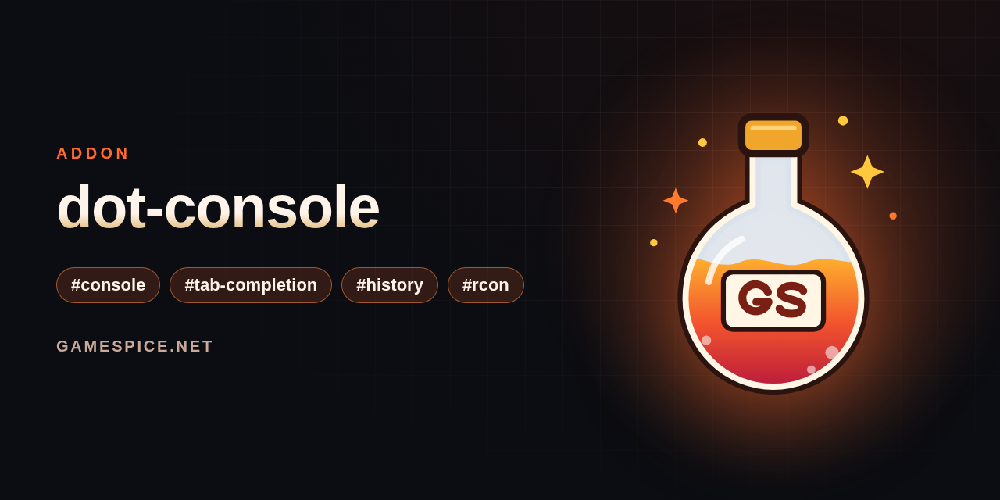

[](https://moddingcommunity.com/a/235-dot-console)

The in-game developer console for Godot 4.7+, opened with a key. It gives you a line editor, history, tab completion, scrollback and a bridge to whatever command system your game already has. Part of the [dot-*](https://github.com/gamespice-platform) family. It needs only [dot-core](https://github.com/gamespice-platform/core).

dot-console is a console, not a command system. dot-server already has commands, cvars, permissions, aliases and completion, and a second copy would drift. dot-console owns the key, line editing, history, scrollback and drawing, and asks sources to run the line.

## Install

1. Copy `addons/dot_console/` and `addons/dot_core/` into your project.
2. Enable dot-console in *Project > Project Settings > Plugins*.

## Sources

Sources are asked in order, and the first that claims a name handles it. A local `quit` therefore quits the client, not the dedicated server.

| Source | What it is for |
| --- | --- |
| `DotConsoleLocal` | Things that belong to the player's own machine: a volume, a bind, a screenshot, `quit`. Works with no server in the process. |
| `DotConsoleBridge` | Wraps anything with `execute` and `complete` (duck typing), so a server's console becomes a source without this addon naming its types. |
| `DotConsoleRemote` | A `send_fn` that puts the line on a wire, for RCON or a chat command. |

## Quick start

```gdscript
var console := DotConsoleController.new()
add_child(console)
console.setup()

var local := DotConsoleLocal.new()
local.add_command(&"quit", "Quit", func(_a): get_tree().quit())
local.bind_setting(&"sensitivity", settings)      # duck-typed; one copy of the value
console.add_source(local)
console.add_source(DotConsoleBridge.wrap(server.console))   # when there is a server

var panel := DotConsolePanel.new()
panel.controller = console
canvas_layer.add_child(panel)
```

Or do all of that in one call. It adds `help`, `clear`, `settings`, a command for every setting the settings manager's schema declares, the server's console when one runs in this process, and the panel on its own CanvasLayer. Given a menu (anything with `add_overlay`), the console registers as one of its overlays, so the game does the same things for the console as for the menu (stop the player, free the pointer).

```gdscript
console = DotConsoleKit.build(self, settings_manager, menu)
```

The one line every game with a console forgets:

```gdscript
if panel.has_keyboard_focus():
    return      # otherwise typing `noclip` walks the player forward
```

See [docs/console-kit.md](docs/console-kit.md).

## Design choices

| Choice | Why |
| --- | --- |
| The key is bound by physical position. | The key under Escape types `` ` `` on a UK keyboard, `^` on a German one and `²` on a French one. Binding a character makes the console unopenable across much of Europe. `open_physical_key` is a physical keycode, and `open_action` is checked first so a player can rebind it. |
| The scrollback is a ring. | An unbounded buffer is a memory leak, and a server logging a line per tick would fill it. The size is `scrollback_lines`. |
| Secrets are redacted. | A password typed into a console lands in scrollback, in history and in screenshots. `DotConsoleLine.redact` keeps the command name and replaces the rest with asterisks of a fixed length, because the length of a password is information too. |
| The controller draws nothing. | `DotConsoleController` is a `Node` with no `Control`. `DotConsolePanel` draws it. That is what makes a headless suite possible. |
| The panel does not use dot-ui. | A console must work when the interface does not. Half its use is finding out why a screen stack is stuck. |

## Settings

Defaults are in `cfg/addon/dot_console/console.yml`. A game overrides them in `cfg/game/<game>/dot_console/`, and the server operator in `cfg/server/addon/dot_console/` or `cfg/server/game/<game>/dot_console/` (strongest). `DotConsoleConfig.new().load_cfg()` reads these, then `DOT_CONSOLE_*` environment variables and `--console-*` flags.

| Setting | Default | What it does |
| --- | --- | --- |
| `open_action` | `dot_console_toggle` | The input action that opens the console. |
| `scrollback_lines` | 2048 | Lines of scrollback kept. The inspector slider runs 16 to 100000. |
| `history_lines` | 128 | Lines of typed history kept. The inspector slider runs 4 to 10000. |
| `chat_command_prefixes` | `/` and `!` | Prefixes treated as chat commands. |

The RCON port, allow-list and password are not this addon's. dot-server-deploy reads `rcon.yml`, and the password stays in a file only.

## Test

```bash
godot --headless --path . --import
godot --headless --path . res://examples/console_selftest.tscn
godot --headless --path . res://examples/cfg_selftest.tscn
```

The self-tests are offline and exit non-zero on any failure. The design is in [docs/design.md](docs/design.md).

## Status

Built and maintained with Claude Code. The test suites pass, but little of this has been in front of real players yet. Please report rough edges by opening an issue.

## Licence

MIT. See [LICENSE](LICENSE). Only the TMC back-end web infrastructure is not open source.
